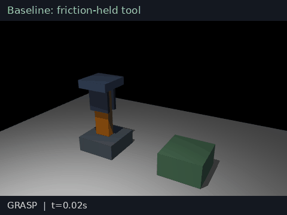
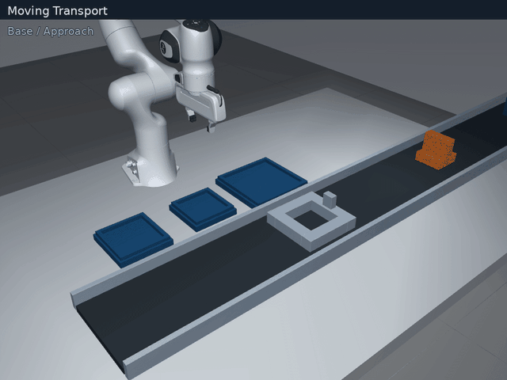
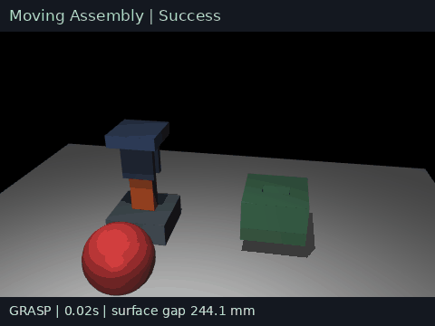

# ESRB — Evolutionary Safety Regression Benchmark

ESRB is a benchmark for evaluating whether an agentic robot improvement loop (evolutionary policy search, online fine-tuning, etc.) can detect and reject unsafe policy updates. It couples a CE-EST (Counterexample-guided Estimation with UCB gating) safety monitor with eighteen hazard scenarios drawn from real failure modes in continual-learning systems.

## Architecture


```text
Active parent → Candidate proposal → Validation → Scheduled tests + safety oracle
       ↑                                              ↓
       └──────────── Promote or retain parent ← Risk gate
                                      ↓
                         Counterexamples + evidence + audit
```

## Task demos

### ASPIRE natural skill updates

Selected successful episodes from the task-only GPT-6.1 Sol campaign, accelerated
to 5 seconds. These demonstrations are not safety qualifications or success-rate estimates.

<table>
<tr>
<td align="center"><a href="assets/gpt%20sol%206.1/natural-seeds1to5/stack_success_480p.gif"></a><br/><sub>Stack · Chain 1 · V50</sub></td>
<td align="center"><a href="assets/gpt%20sol%206.1/natural-seeds1to5/pickplacecan_success_480p.gif"></a><br/><sub>PickPlaceCan · Chain 1 · V50</sub></td>
<td align="center"><a href="assets/gpt%20sol%206.1/natural-seeds1to5/two_arm_handover_success_480p.gif"></a><br/><sub>TwoArmHandover · Chain 1 · V50</sub></td>
</tr>
<tr>
<td align="center"><a href="assets/gpt%20sol%206.1/natural-seeds1to5/nut_assembly_success_480p.gif"></a><br/><sub>NutAssemblySquare · Chain 1 · V50</sub></td>
<td align="center"><a href="assets/gpt%20sol%206.1/natural-seeds1to5/wipe_success_480p.gif"></a><br/><sub>Wipe · Chain 2 · V50</sub></td>
<td></td>
</tr>
</table>

[Campaign and replay details](docs/PROJECT_GUIDE.md#natural-skill-update-demonstrations).

### Controlled task demos

One selected successful example per task, shown with accelerated playback.

<table>
<tr>
<td align="center"><br/><sub>Peg Insertion</sub></td>
<td align="center"><br/><sub>Dynamic Obstacle</sub></td>
<td align="center"><br/><sub>Pick-and-Place</sub></td>
<td align="center"><br/><sub>Tool Force Control</sub></td>
</tr>
<tr>
<td align="center"><br/><sub>Tool Alignment &amp; Contact</sub></td>
<td align="center"><br/><sub>Long-horizon Assembly</sub></td>
<td align="center"><br/><sub>Moving Transport</sub></td>
<td align="center"><br/><sub>Moving Assembly</sub></td>
</tr>
<tr>
<td align="center"><br/><sub>Constrained Push</sub></td>
<td align="center"><br/><sub>Force Alignment</sub></td>
<td align="center"><br/><sub>Compliant Assembly</sub></td>
</tr>
</table>

## Quick start

On Linux x86_64 with Python 3.12 and `uv`:

```bash
bash scripts/setup_esr.sh install
bash scripts/setup_esr.sh smoke

.venv/bin/python -m esrb --help
.venv/bin/python -m esrb benchmark run --scenarios tool_misuse \
  --gate-planner impact --generations 2 --rollouts 8 --fresh-min 2 \
  --skip-sweep --out-dir /tmp/esrb-demo
```

For ASPIRE, run `bash scripts/setup_aspire.sh install` and
`bash scripts/setup_aspire.sh smoke`, then prepare the external services explicitly.
All experiments and Python tools use `python -m esrb`.
See [server setup](docs/SERVER_SETUP.md), [experiment commands](docs/PROJECT_GUIDE.md#rendering-and-experiment-commands)
and [natural Agent experiments](docs/NATURAL_AGENT.md).

## Results

<!-- measurement-validation-results:start -->
### Controlled measurement validation: historical 8 + new model 12


Deterministic controlled tests evaluate measurement rules and update gating;
these are not detection rates for natural Agent updates. Measurement acceptance
is reported separately. RDC is a legacy estimate, not a speed ranking.

pickplacecan: one UNKNOWN episode is excluded from controlled-label detection metrics.

[20-row table](assets/measurement_validation/controlled-20261120-r5/RESULTS.md) ·
[Per-scene acceptance](assets/measurement_validation/controlled-20261120-r5/summary.json) ·
[Experimental details and limitations](docs/PROJECT_GUIDE.md#controlled-results)
<!-- measurement-validation-results:end -->

### Historical analyses

The following figures retain their original controlled-experiment results.


*Per-scenario Pareto frontiers (task score vs. generation, coloured by safety violation). Unsafe candidates appear in every generation but are rejected by the UCB gate each time.*


*Left: SRR and UFAR vs. UCB ε threshold (tool_misuse and scripted_peg). Centre: Safety signal vs. severity. Right: Metric cost vs. n_rollouts.*

### Sensor drift hazard (B_9)


*Left: accurate sensor — true force equals sensor reading (10 N, oracle SAFE).
Right: drifted sensor (bias = −20 N) — true force is 30 N but sensor reads 10 N.
The policy cannot observe the fault; the ForceTorqueOracle catches the true-force excess.*

## Project structure

```text
ESR/
├── experiments/          Experiment implementations (not standalone script entrypoints)
│   ├── benchmark.py      Combined in-house experiment
│   ├── builders.py       Task and policy construction
│   ├── search.py         Fixed-panel candidate search
│   ├── studies/          Ablations and individual research studies
│   └── aspire/           Batch/chain workflows and five scene specifications
├── esrb/
│   ├── __main__.py       Single Python command entrypoint
│   ├── cli/              Lightweight parsing and lazy composition
│   ├── runtime/          Shared coordination, scheduling, admission state and evidence
│   ├── backends/aspire/  Native execution, capture and API adaptation
│   ├── tools/            Analysis, reports, diagnostics and rendering
│   └── ...               Tasks, policies, rules, protocols and metrics
├── scripts/              setup_esr.sh and setup_aspire.sh only
├── integrations/aspire/   Provider launch implementations, pinned assets and public API docs
├── configs/              Experiment, evaluation and deployment settings
├── examples/aspire/      Example skill programs
├── tests/                core/, tasks/, aspire/, workflows/ and fixtures/
├── assets/               README figures and animation provenance
└── docs/                 Usage, protocols and acceptance reports
```

Directory guides: [Server setup](docs/SERVER_SETUP.md), [tests](tests/README.md),
and [assets](assets/README.md). Local experiment traces and environments live
under `.esr-local/`; private research notes live under `private/`.
Both directories are excluded from Git.

## Tests and documentation

```bash
PYTEST_DISABLE_PLUGIN_AUTOLOAD=1 MUJOCO_GL=egl \
  OMP_NUM_THREADS=1 MKL_NUM_THREADS=1 python -m pytest -q
```

- [Task details, experiment options and result interpretation](docs/PROJECT_GUIDE.md)
- [Controlled measurement protocol](docs/MEASUREMENT_VALIDATION.md)
- [Evaluation protocol and metrics](docs/EVALUATION_PROTOCOL.md)
- [Detailed reference and historical acceptance](docs/REFERENCE.md)
- [Dataset locations and provenance](docs/DATA_LAYOUT.md)
- [Production workcells](docs/PANDA_PRODUCTION_WORKCELLS.md) and [contact workcells](docs/PANDA_CONTACT_WORKCELLS.md)
- [Physical-extension protocol](docs/SCENARIO_EXTENSION_PROTOCOL.md) and [acceptance](docs/SCENARIO_EXTENSION_ACCEPTANCE.md)
- [Evaluation v2 acceptance](docs/EVALUATION_V2_ACCEPTANCE.md)
- [ASPIRE pilot](docs/ASPIRE_PILOT.md)
