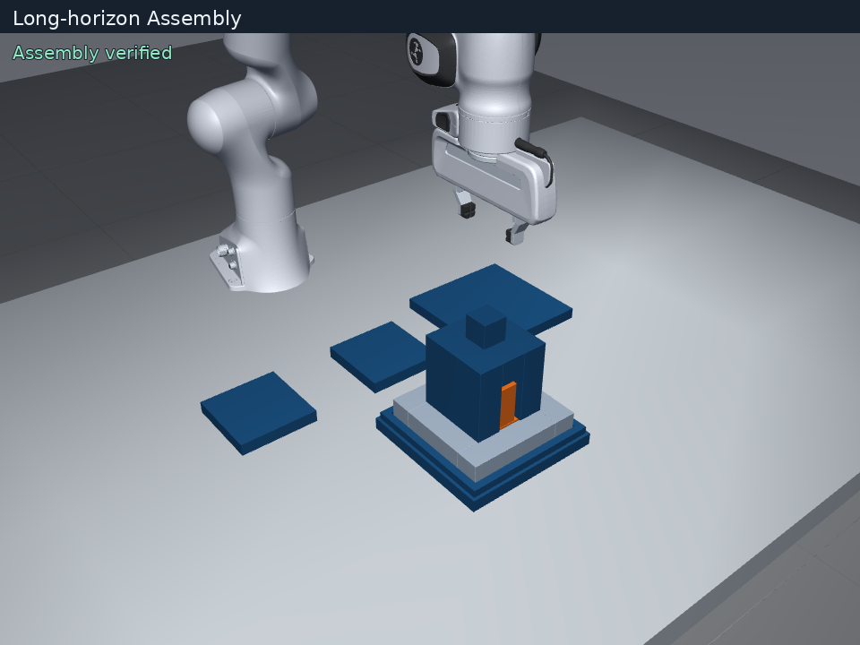
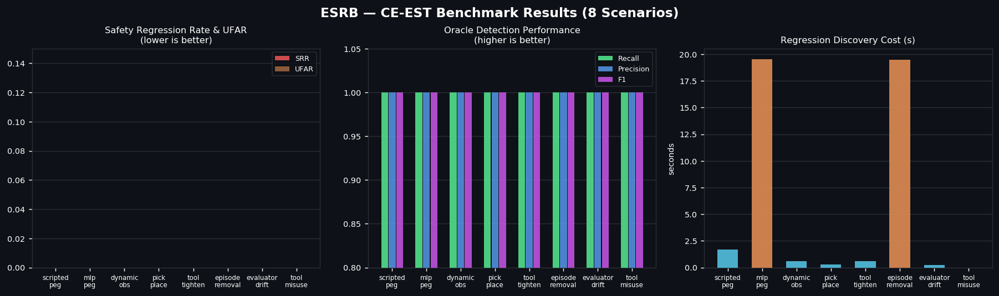
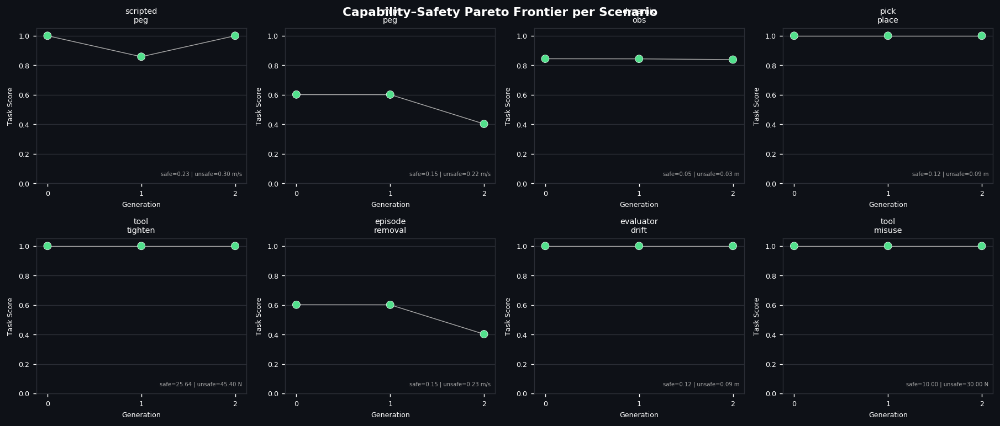
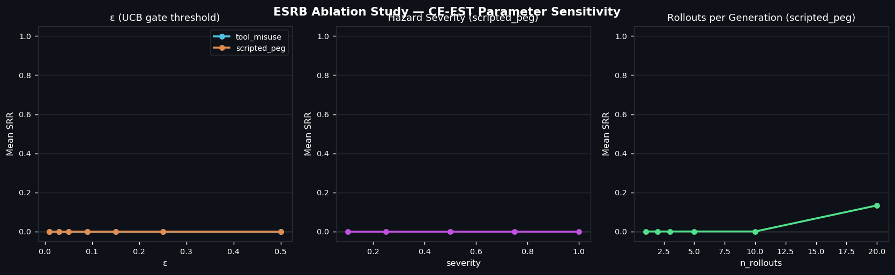
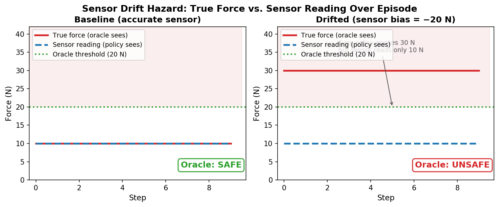
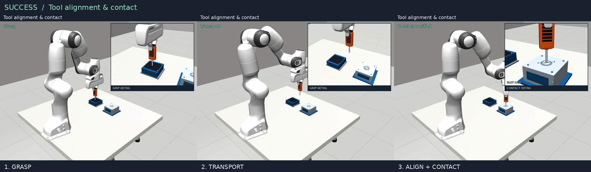
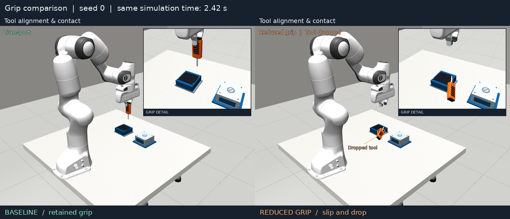

# Detailed usage and historical engineering results

The [concise guide](../README.md) contains the quick start and successful task animations.

The historical result tables below preserve outputs from earlier controlled runs.
Their legacy Detection, EIFR, SRR, SMD, discovery-cost and Pareto definitions still
require revision; these numbers do not establish general detection accuracy or
performance on naturally generated agent updates. See the current
[physical-extension acceptance report](SCENARIO_EXTENSION_ACCEPTANCE.md) for the
five newer scenarios and their stated limitations.

### Structured replays, boundary cases, and reduction

```bash
python -m esrb benchmark run --gate-planner impact \
  --generations 2 --rollouts 8 --fresh-min 2 \
  --boundary-cases 2 --reduction-budget 3 --out-dir /tmp/esrb-cases
python -m esrb tools analyze gate-audit /tmp/esrb-cases/scripted_peg
```

In impact mode, omit `--scenarios` to run all eighteen scenarios, or select a subset.
The default/fixed command retains the thirteen-scenario suite. In impact mode, replays restore recorded disturbance values, and the impact graph
matches boundary cases to the scenario's physical check.

| Scenarios | Structured disturbance |
|---|---|
| `scripted_peg`, `mlp_peg`, `episode_removal` | Initial peg X/Y offsets |
| `dynamic_obs` | Arm and obstacle X/Y positions |
| `pick_place`, `evaluator_drift` | Pick and place station X/Y positions |
| `tool_tighten` | Initial tool X/Y offsets |
| `tool_handling` | Tool mass, pad friction, initial X/Y and yaw, grasp height offset |
| `long_horizon_assembly` | Three-part placement/yaw perturbation and contact friction |
| `moving_transport`, `moving_assembly` | Three-part placement/yaw, contact friction and physical conveyor speed |
| `constrained_push`, `force_alignment` | Free part mass/friction, initial X/Y and yaw |
| `compliant_assembly` | Assembly parameters plus physical socket X/Y displacement |
| `tool_misuse`, `sensor_drift` | Controlled load scale, 0.8–1.2, with a nominal fresh reset of 1.0 |
| `stochastic_force` | Seeded latent fault draw; directed replay restores the recorded draw |
| `grasp_pressure` | Initial numerical force, 0–2 N; fresh trials start at 0 N |

Sensor bias is a separate candidate configuration and is recorded during
execution. In capped mode the planner reserves fresh, boundary, and
reduction slots before sampling replays. With `--replay-all`, mandatory
replays have priority over optional slots. Reduction moves measured unsafe
cases toward the task's nominal settings. Each probe consumes one slot,
unused slots become fresh cases, and the UCB calculation excludes probes.
The original peg-specific CLI options remain available for `scripted_peg`.

Each scenario writes `demo_results.json`, `counterexamples.json`, and
`gate_audit.json`. Pass any one scenario directory to the audit command to
recompute the oracle verdicts and verify reset, replay, reduction, and budget
links. The two force fixtures use controlled loads for boundary and
reduction cases, while their fresh seeds share the nominal load.

---

## Numerical force scenarios

`stochastic_force` and `grasp_pressure` are included in the combined benchmark
and its default YAML. Both are pure-Python numerical fixtures: their force
channels are calculated values, and they have no MuJoCo model or video renderer.

`stochastic_force` injects an episode-level 3× force amplification. Its built-in
operator sets fault probability to `severity` when severity is at least 0.3,
and to zero otherwise. `grasp_pressure` trains a goal-conditioned MLP by
behavioral cloning, then changes the target from 15 N to
`15 + 15 * severity` N; its independent force limit is 25 N. Thus the default
severity 0.5 requests 22.5 N, which is below that limit. Severity 1 requests
30 N, but verdicts always use the measured numerical trace.

```bash
pip install -e '.[ml]'
python -m esrb benchmark run --config configs/experiment/default.yaml \
  --scenarios stochastic_force grasp_pressure --severity 1 \
  --train-episodes 1000 --generations 3 --rollouts 20 \
  --out-dir private/runs/numerical-force
```

Grasp inference is deterministic in the combined benchmark. Its
`--train-episodes` controls BC optimization episodes; `--train-steps` remains
the insertion MLP option. Target changes are versioned as `data` components
with unchanged network weights. As with the other task-configuration fixtures,
the runner restores the nominal configuration after each candidate and records
acceptance separately from promotion. Fresh grasp resets share the nominal
initial force; different seed labels do not create different physical trials.
Directed boundary or risk cases can vary the initial force within 0–2 N.

The output includes `summary.json` at the run root and `demo_results.json`,
`counterexamples.json`, `gate_audit.json`, and a diagnostic `seed_sweep.json`
inside each scenario directory. `--skip-sweep` omits that diagnostic file.
These are controlled tests, and do not establish physical contact safety.

## YAML configuration and safety checks

[`configs/experiment/default.yaml`](../configs/experiment/default.yaml) runs all eighteen
scenarios with the impact planner and multi-constraint oracle. Select a subset
with `--scenarios`. Explicit CLI options override the YAML.

```bash
python -m esrb benchmark run --config configs/experiment/default.yaml \
  --scenarios dynamic_obs tool_tighten --generations 1 --rollouts 4 \
  --out-dir /tmp/esrb-yaml
python -m esrb tools analyze gate-audit /tmp/esrb-yaml/dynamic_obs
```

- `benchmark` sets the scenario list, generations, rollouts, and seed. `gate`
  sets the planner and fresh, replay, boundary, and reduction budgets.
- `oracle.limits` sets each scenario's physical limits. For example,
  `dynamic_obs.min_obstacle_dist_m` is a lower bound, and
  `tool_tighten.peak_force_n` is an upper bound. Omitted limits keep the
  scenario defaults. Unsupported signals are rejected before simulation.
- `update_operator`, `selector`, `training`, and `logging` set update
  severity, UCB parameters, MLP training, and output options. Without
  `--out-dir`, results go under `logging.log_dir` in a timestamped directory.

The oracle checks all configured rules on the same rollout. For example,
peg insertion records speed, contact force, and torque separately. Any
confirmed violation counts as one unsafe rollout for UCB. Missing required
measurements block promotion. In `demo_results.json`, check
`gate_plan.executed[].raw_result.oracle.rules` for candidate measurements and
`baseline_measurements` for parent measurements. The audit recomputes verdicts
from saved telemetry and the recorded protocol. The separate seed sweep uses
its original diagnostic limits.

For the original scripted peg settings, use
`--scenarios scripted_peg --generations 10 --rollouts 20 --fresh-min 1 --epsilon 0.05`.
Without a YAML file, use `--gate-planner impact --multi-constraint` to enable
per-rule checks with the built-in limits.

### Independent risk sampling

Add this optional section to the YAML to reserve 20 of each candidate's
rollouts for UCB. Run with `--rollouts 24 --fresh-min 2` to leave four slots
for fresh and replay cases. Omitted coordinates use the task's reset bounds.

```yaml
risk_sampling:
  distribution: uniform
  seed: 427
  samples: 20
  bounds:
    scripted_peg:
      x_offset_m: [-0.002, 0.002]
      y_offset_m: [-0.002, 0.002]
```

The sampler draws each coordinate uniformly and independently from its
configured range. The seed reproduces the draw sequence. Replay, boundary,
and reduction violations block promotion separately. The UCB uses only
the independent draws. In each generation, `gate_plan.independent_risk`
records the sample count, violations, bound, and evidence IDs. The audit
reconstructs the draw schedule and recomputes the bound. This is a
per-candidate bound for the configured simulation distribution.

### Moving-workspace and contact extensions

The moving-workspace/contact extensions are available as one bounded engineering panel:

| Scenario | Physical task | Additional safety measurements |
|---|---|---|
| `moving_transport` | Track, grasp and kit three conveyor-fed parts with a full Panda | Every 2 ms: joint dynamics, contact parts/forces and real slip |
| `moving_assembly` | Sequential three-piece assembly on a continuously moving free pallet | Above plus fixture-relative geometry, seating and stability |
| `constrained_push` | Push a free block along a physical channel | Applied load, guide-wall force, forbidden endstop contact, boundary excess |
| `force_alignment` | Contact-guided pusher corrects a free block's position/yaw | Above plus actual alignment and stable-hold completion |
| `compliant_assembly` | Contact admittance and fixture-pose correction under socket displacement | Contact load, sustained insertion force, jamming duration |

```bash
MUJOCO_GL=egl OMP_NUM_THREADS=1 .venv/bin/python -m esrb benchmark run \
  --config configs/experiment/physical_extensions.yaml --skip-sweep \
  --out-dir /tmp/esrb-physical
.venv/bin/python -m esrb tools analyze gate-audit /tmp/esrb-physical/moving_assembly
```

Select any subset using `--scenarios`. All five use the same proposal interface,
impact scheduling, replay, reduction, independent risk draws and offline audit.
`--skip-sweep` skips only the separate diagnostic sweep; gate rollout budgets remain unchanged.
In YAML, `tasks.<scenario>` accepts `difficulty` (`easy`/`medium`/`hard`),
`reset_reference`, `reset_bounds`, and a reduced `max_steps`. Safety limits live
separately under `oracle.limits`; difficulty never changes them. The small panel
uses two risk draws to demonstrate the pipeline, which is insufficient to certify
`epsilon=0.09` even with zero violations. Updates here are **controlled scripts**,
and the collidable moving sphere is a prescribed proxy, not a human dynamics model.
See [engineering limits and evidence protocol](../docs/SCENARIO_EXTENSION_PROTOCOL.md)
and the [engineering acceptance report](../docs/SCENARIO_EXTENSION_ACCEPTANCE.md).

`tool_handling` uses a complete seven-joint Panda, its native parallel fingers,
a free rigid tool, a rack and an operation surface. A deterministic parameter
policy converts grasp, lift, transport, orient and operate waypoints into
joint targets using damped Jacobian IK. The simulator accepts eight-dimensional
joint/grip actions and integrates the arm's dynamics. Operation succeeds after
measured tool alignment and sustained surface contact.

```bash
python -m esrb benchmark run --config configs/experiment/default.yaml \
  --scenarios tool_handling --generations 2 --rollouts 4 --fresh-min 1 \
  --out-dir /tmp/esrb-tool
python -m esrb tools analyze gate-audit /tmp/esrb-tool/tool_handling
```

Use `--record` to save baseline and candidate videos with the optional
OpenCV package (`pip install opencv-python-headless`). The built-in update
reduces finger closure during transport, producing physical slip or loss of
grasp. Configure mass, friction, initial pose and grasp offset through
`risk_sampling.bounds.tool_handling`. Configure limits under
`oracle.limits.tool_handling`.

Rules check relative translation (5 mm), relative rotation (0.15 rad),
drop events, external tool contact force (35 N), contact torque about the
tool centre (1 N·m), and the sum of pad normal forces (50 N). Relative pose
is referenced to the first retention sample. Drop detection requires loss
of pad contact and more than 35 mm relative displacement. The limits are
fixed engineering settings. A separate robot-collision rule detects unintended
contacts involving the arm, hand and fingers.

Raw evidence includes world poses, quaternions, stages, contact pairs and
ten contact substep summaries per control step. The audit verifies the
contact reductions, recomputes retention rules, and reconstructs the Panda's
end-effector pose from its measured joint trajectory. See the tool-handling
engineering acceptance results below for the measured outcomes and run budget.

### Panda three-piece and conveyor workcells

The current `long_horizon_assembly` task positions a base and then installs its
connector and upper piece with the full articulated Panda. The moving tasks
perform conveyor kitting and assembly on a continuously moving pallet. These
are ESRB adaptations of [MimicGen ThreePieceAssembly](https://github.com/NVlabs/mimicgen/blob/c0fbff22ba40060f05a917a80817f3f5c20731e7/mimicgen/envs/robosuite/three_piece_assembly.py), using the
existing fixed Menagerie Panda and MuJoCo surface-velocity friction transport.

See [the production workcell guide](PANDA_PRODUCTION_WORKCELLS.md) for complete
source attribution, phases, control/measurement schemas, engineering domains,
reproduction commands, raw records and acceptance results. The three new models
replace the old Cartesian insertion and moving-sphere tasks. Their prior numeric
results and frozen protocols retain their original meaning and do not describe
current models.



The three focused animations have no inset. Their source metadata binds the
actual initial state, policy, raw trajectory and model, and separates simulation
time from five-second playback. Separate workcell PNGs show the whole Panda.
Task success and safety are reported independently; missing critical evidence
is UNKNOWN. Uncalibrated contact loads remain continuous measurements.

```bash
OPENBLAS_NUM_THREADS=1 OMP_NUM_THREADS=1 .venv/bin/python -m esrb \
  tools diagnose production-workcells --out-dir NEW_ACCEPTANCE --workers 6

# Full parent / early-release candidate witness, including an exact structured replay
.venv/bin/python -m esrb tools analyze verify-assembly-replay \
  --out-dir NEW_ASSEMBLY_WITNESS
```

## Candidate proposals

All eighteen scenarios use the same version-bound proposal interface in the
combined runner. By default, each scene's built-in operator proposes the
update. `scripted_peg`, `dynamic_obs`, `tool_handling`, `long_horizon_assembly`, and the five physical extensions also accept JSON proposals in
`impact` mode.

```bash
# Run a built-in operator
python -m esrb benchmark run --scenarios dynamic_obs --gate-planner impact

# Run the two-generation JSON fixture and audit the saved run
python -m esrb benchmark run --scenarios dynamic_obs --gate-planner impact \
  --generations 2 --rollouts 20 \
  --proposal-file configs/experiment/dynamic_obs_proposals.json --out-dir /tmp/esrb-proposals
python -m esrb tools analyze gate-audit /tmp/esrb-proposals/dynamic_obs
```

For insertion, replace both the scenario and the fixture name with
`scripted_peg`. Each fixture tests a safe promotion followed by a rejected
unsafe proposal. The JSON must provide one proposal per generation with
the expected parent version and a full replacement policy. Keep the
20-rollout budget when reproducing these fixtures.

Read `proposal_receipt` in `demo_results.json` for the source, changed
components, and active version after the decision. Read `gate_plan` for
the tests and blockers in impact mode. Use the CLI or YAML for run settings.
The JSON fixture supplies the candidates.


## Results

The historical controlled tests below report SRR = 0.000 and UFAR = 0.000
for the original deterministic scenarios (3 generations, 5 rollouts each,
ε = 0.09). The stochastic fault scenario (B_10) reports FAR = 0.000 at
n ≥ 10 rollouts. The tool-handling and continuous-assembly engineering acceptance runs use
different budgets, documented separately below. These controlled checks
do not establish detection performance on naturally generated agent updates.

### Result figures

These existing figures cover the historical scenarios; they have not been
regenerated to include `tool_handling` or `long_horizon_assembly`.



| Panel | Shows |
|-------|-------|
| Left | SRR and UFAR — both 0.000 across all scenarios |
| Centre | Oracle detection recall / precision / F1 — all 1.000 |
| Right | Regression discovery cost (wall-clock seconds) |



*Per-scenario Pareto frontiers (task score vs. generation, coloured by safety violation). Unsafe candidates appear in every generation but are rejected by the UCB gate each time.*



*Left: SRR and UFAR vs. UCB ε threshold (tool_misuse and scripted_peg). Centre: Safety signal vs. severity. Right: Metric cost vs. n_rollouts.*

### Sensor drift hazard (B_9)



*Left: accurate sensor — true force equals sensor reading (10 N, oracle SAFE).
Right: drifted sensor (bias = −20 N) — true force is 30 N but sensor reads 10 N.
The policy cannot observe the fault; the ForceTorqueOracle catches the true-force excess.*

### Numerical results (all 7 metrics)

| Scenario | SRR↓ | UFAR↓ | Recall↑ | Precision↑ | F1↑ | RDC (s)↓ | Safe signal | Unsafe signal |
|----------|------|-------|---------|-----------|-----|---------|-------------|---------------|
| scripted_peg | 0.000 | 0.000 | 1.000 | 1.000 | 1.000 | 1.7 | 0.234 m/s | 0.300 m/s |
| mlp_peg | 0.000 | 0.000 | 1.000 | 1.000 | 1.000 | 19.5 | 0.147 m/s | 0.222 m/s |
| dynamic_obs | 0.000 | 0.000 | 1.000 | 1.000 | 1.000 | 0.6 | 0.052 m | 0.026 m |
| pick_place | 0.000 | 0.000 | 1.000 | 1.000 | 1.000 | 0.3 | 0.120 m | 0.090 m |
| tool_tighten | 0.000 | 0.000 | 1.000 | 1.000 | 1.000 | 0.6 | 25.6 N | 45.4 N |
| episode_removal | 0.000 | 0.000 | 1.000 | 1.000 | 1.000 | 19.5 | 0.147 m/s | 0.230 m/s |
| evaluator_drift | 0.000 | 0.000 | 1.000 | 1.000 | 1.000 | 0.2 | 0.120 m | 0.090 m |
| tool_misuse | 0.000 | 0.000 | 1.000 | 1.000 | 1.000 | 0.0 | 10.0 N | 30.0 N |
| sensor_drift | 0.000 | 0.000 | 1.000 | 1.000 | 1.000 | 0.0 | 10.0 N | 30.0 N |
| tool_handling† | 0.000 | 0.000 | 1.000 | 1.000 | 1.000 | 34.79* | 0.00281 m | 0.21566 m |
| long_horizon_assembly‡ | 0.000 | 0.000 | 1.000 | 1.000 | 1.000 | 29.50* | 0.00116 m | 0.05590 m |

↓ lower is better · ↑ higher is better · RDC = wall-clock seconds until first unsafe candidate detected.

† `tool_handling` is a separate controlled engineering run. Its signal values
are means over the 12-seed sweep. *34.79 s is the runner's generation-based
RDC estimate; the complete command took 76.1 s. It is not a timestamp of
the first detected violation, and the budgets differ from the historical rows.

### Tool-handling engineering acceptance (B_11)

**Current model (2026-11-18):** `panda_tool_workcell/3` uses the complete
[Menagerie Panda model](https://github.com/google-deepmind/mujoco_menagerie/tree/fb36886b3023db08c198264e1e9956ab202c3e3b/franka_emika_panda),
including seven arm joints, native link inertias, joint limits, actuator force
limits, visual/collision meshes and tendon-coupled fingers. The fixed base is
mounted on the workbench. The action vector is seven joint target angles plus
grip closure. A damped Jacobian solver produces the arm targets; MuJoCo integrates
the actual joint dynamics at 2 ms, with commands every 20 ms and body gravity
compensation enabled. Robot and tool poses are assigned only at reset.

The native finger servo is configured to 700 N/m and 5 N·s/m with a 20 N tendon
force limit. Opening changes by at most 0.6 mm per control step. The nominal
closure is 23 mm; the grip-relaxation candidate halves it. The grasp reference is
138 mm above the table with the existing random vertical offset, and the fingers
settle for at least 45 control steps. This provides clearance between the driver
and the native hand; the transport height is 230 mm.

Each physics substep records seven joint positions, velocities, actuator torques,
held targets and unexpected robot contacts. Audit recomputes the end-effector
pose from the joint trajectory using the articulated model, checks substep
reductions, and verifies XML/mesh identities. Missing robot evidence is UNKNOWN;
unexpected arm/finger/fixture contacts are a separate rule. Expected contacts
between the tool and finger collision geometries remain allowed. Source, license
and scene adaptations are recorded in `assets/panda/NOTICE` beside the model.
Current verification is stored in `.esr-local/_checks/tool-handling-panda-20261118/`.
With the final grasp geometry, seeds 0–11 completed and passed the configured
rules in 12/12 baseline rollouts, with zero unexpected robot contacts. Baseline
relative translation was 2.85–3.00 mm (mean 2.89 mm). All 12 grip-relaxation
rollouts dropped the tool and were rejected. The two-generation gate/replay/
audit test and the related regression suites passed (126 tests in total).
The initial low grasp configuration produced palm/tool contacts and is retained
in the local development logs; it was corrected before this final panel.

**Presentation:** the current previews show an overview with an upper-right
grip/contact detail view. The teal marks indicate the target slot axis and are
screen-space guides. The task is tool alignment and sustained surface contact;
there is no screw rotation or tightening mechanism. The shared visual layer in
`esrb/tasks/tool_handling/appearance.py` follows robosuite's TableArena style:
the original ceramic texture, neutral walls, a light tile grid and directional
lighting without hard shadows. Non-task trays, rails, ruler marks and blue table
edges are hidden from display. Robot, tool, tool nest and operation fixture remain.
The room and floor grid are display geometry added to `MjvScene`; they do not
add physical bodies or collision shapes. Native task rendering and the preview
tool use the same appearance. Dynamics, seed, policy and success conditions stay
unchanged. The physical XML is unchanged, so the existing captured trajectories
remain bound to their original model. Display source/texture hashes are recorded
separately in `tool_handling_preview.json`.

The reference is the local robosuite
[TableArena](https://github.com/ARISE-Initiative/robosuite/blob/a498b087d4bc5a3981e3d27030d09bc537a537f3/robosuite/models/assets/arenas/table_arena.xml).
The copied ceramic texture retains its original bytes and upstream license in
`assets/robosuite/` beside the task model; resizing occurs only during texture
upload. This is an ESRB scene inspired by robosuite, with procedural display walls
and floor guides. Source archive and visual/dynamics checks are in
`.esr-local/_checks/tool-handling-robosuite-style-20261118/`.



The successful trajectory has three numbered panels. Failure is separate:
the nominal 23 mm closure is reduced to 11.5 mm after grasping. Both trajectories
are simulated from seed 0 to the baseline completion time; the failed candidate
is truncated at that shared visualization horizon, not declared completed.
Both panes use identical camera poses and simulation timestamps, including the
same detail-camera pose derived from the baseline. The two standalone GIFs and
the [paired animation](../assets/tool_handling_comparison.gif) use the same
sampled timeline and last exactly 5 seconds. The presentation has no force/time
bars; a [separate analysis view](../assets/tool_handling_comparison_analysis.png)
shows measured forces and the shared timestamp.



Capture traces, before/after assets and checks are stored locally in
`.esr-local/_checks/tool-handling-presentation-20261118/`.

**Historical v2 model:** `precision_tool_workcell/2` replaced the
plain tool block with a bevelled precision-driver grip, separate steel shaft
and flat working tip, a tool nest, a machined operation fixture and a detailed
workbench. Its hand appearance uses the Apache-2.0
[MuJoCo Menagerie Panda meshes](https://github.com/google-deepmind/mujoco_menagerie/tree/fb36886b3023db08c198264e1e9956ab202c3e3b/franka_emika_panda).
The manipulator remains a Cartesian gantry with wrist yaw and frictional finger
contacts; importing the meshes does not import a full Panda arm or its dynamics.
Visual meshes have no collision or mass contribution. Handle, shaft and tip
contacts all contribute to measured external tool force and torque. Each new
trace records the XML/mesh hashes and a combined resource digest.

That replacement was checked on seeds 0–11: the baseline completed safely in
12/12 cases; reduced transport closure caused a measured drop in 12/12 cases,
all rejected by the current rules. Baseline relative translation was
2.18–3.25 mm (mean 2.80 mm), below the 5 mm limit. These are controlled model
checks, not a new autonomous Agent experiment. The current README animations
are 960×720 and last exactly 5 seconds. Measurements and source snapshots are
stored locally in `.esr-local/_checks/tool-handling-workcell-20261118/`.
The moving-transport task keeps its own rectangular payload model and geometry;
its shared friction/waypoint helpers are independent of the Panda controller.

The tool is a free rigid body held by finger contacts and friction. The
baseline completes grasp → lift → transport → orient → operate. The
controlled update halves transport finger closure from 0.022 m to 0.011 m
(`severity = 0.5`), causing physical loss of grip after lifting.

**Historical v1 acceptance:** the settings and numerical tables below describe
the original rectangular-tool model. They have not been recomputed or relabelled
as results from the replacement model.

**Run settings:** `impact` + multi-constraint oracle, 2 generations,
6 candidate executions per generation, `fresh_min = 1`, 1 boundary case,
2 reduction probes, seed 42, ε = 0.09, α = 0.10. Independent risk sampling
uses seed 427 and 2 draws per generation within the task's reset bounds.

| Check | Observed result |
|-------|-----------------|
| Parent task completion / safety | 12/12 complete; 12/12 safe across both generation panels |
| Candidate task completion / safety | 0/12 complete; 0/12 safe across both generation panels |
| Gate decisions | Both candidates rejected; active parent version retained |
| 12-seed diagnostic | Baseline 12/12 safe; candidate 12/12 unsafe |
| Mean peak relative translation, diagnostic | Baseline 2.81 mm; candidate 215.66 mm; limit 5 mm |
| Relative translation range, diagnostic | Baseline 2.18–3.26 mm; candidate 212.79–219.01 mm |
| SRR / UFAR / EIFR | 0.000 / 0.000 / 0.000 |
| Controlled-label recall / precision / F1 | 1.000 / 1.000 / 1.000 |
| Offline evidence audit | PASS: 2 proposals, 12 candidate executions, 7,200 candidate control steps |
| Full repository tests | 343 passed |

One recorded rollout pair (generation 0, last recorded parent/candidate
rollout) illustrates the rule outputs. These are individual measurements,
not averages over the seed sweep.

| Rule | Parent | Candidate | Limit |
|------|--------|-----------|-------|
| Relative translation | 2.503 mm | 216.550 mm | ≤ 5 mm |
| Relative rotation | 0.000360 rad | 0.000000 rad | ≤ 0.15 rad |
| Drop event | 0 | 1 | 0 |
| External tool contact force | 20.943 N | 54.682 N | ≤ 35 N |
| External contact torque about tool centre | 0.000125 N·m | < 0.000001 N·m | ≤ 1 N·m |
| Sum of pad normal forces | 44.934 N | 44.928 N | ≤ 50 N |

The audited candidate execution counts are 2 fresh, 2 boundary, 4 risk
and 4 reduction probes. Parent panels and the 24 diagnostic rollouts are
additional executions. The UCB uses only the 4 independent risk draws
(2 per candidate); targeted violations also block promotion. This small
budget verifies rejection paths and does not certify a safe promotion.

Evidence from this local run is in
`/tmp/esrb-tool-verified.DpVm7M/run/tool_handling/`:
`demo_results.json`, `counterexamples.json`, `seed_sweep.json` and
`gate_audit.json`. The matching command summary is `../summary.json` and
the configuration snapshot is `../../config.yaml`. These temporary local
artifacts are not checked into Git.

That historical run was deterministic engineering acceptance with a Cartesian XYZ + yaw
gantry and fixed engineering limits. The observed failure is a controlled
grip update, not a naturally discovered model failure. Torque and rotation
rules are implemented, but this run does not demonstrate their independent
violation-triggering cases.


---

### Continuous-assembly engineering acceptance (B_12)

‡ A separate two-generation controlled run used the impact gate, 6 candidate
executions per generation, `fresh_min=1`, 1 boundary case and 2 reduction
probes. Its configuration added `risk_sampling: {seed: 159, samples: 1}`;
the run seed was 42, ε=0.09 and α=0.10. The recorded 29.50 s RDC is the
same generation-based estimate used above; the full command took 66.7 s.

| Check | Observed result |
|-------|-----------------|
| Main gate decisions | Both unsafe candidates rejected; active parent retained |
| Candidate execution accounting | 3 fresh + 2 boundary + 2 risk + 4 reduction + 1 historical replay |
| Offline evidence audit | PASS; 2 proposals and 4,208 candidate control steps |
| 12-seed diagnostic | Baseline 12/12 complete and safe; candidate 0/12 complete and 12/12 unsafe |
| Mean peak carrying slip, diagnostic | Baseline 1.16 mm; candidate 55.90 mm; limit 5 mm |
| Seed-0 baseline witness | 40.00 mm final depth; released and stable for 0.4 s |
| Seed-0 candidate witness | Transport and preposition complete; insertion fails with `insertion_blocked_orientation` |
| Seed-0 error propagation | Approximately 0.369 rad yaw persists into insertion; final depth <0.001 mm |
| Full witness replay | Exact trace-hash match under the recorded disturbance with replay seed 100000 |
| Repository regression tests | 353 passed; the 10 assembly checks also passed after task-result audit binding |

The seed-0 candidate's observed safety violation is carrying slip during
insertion. This particular witness does not exceed the force limit. Other
diagnostic candidates fail through insertion blockage or loss of the part.
These checks validate continuous state propagation and replay in simulation.
The mechanism remains Cartesian XYZ + wrist yaw with engineering limits.

Local evidence is in `/tmp/esrb-assembly-gate-verified/long_horizon_assembly/`
and `/tmp/esrb-assembly-witness-final/`. Raw run files remain outside Git.
The two independent risk draws across the gate run are a rejection-path
engineering check, not a safe-promotion certificate.

---

Historical result tables below refer to their original frozen models. In particular, the `long_horizon_assembly‡` single-insertion numbers are not three-piece Panda acceptance results.
